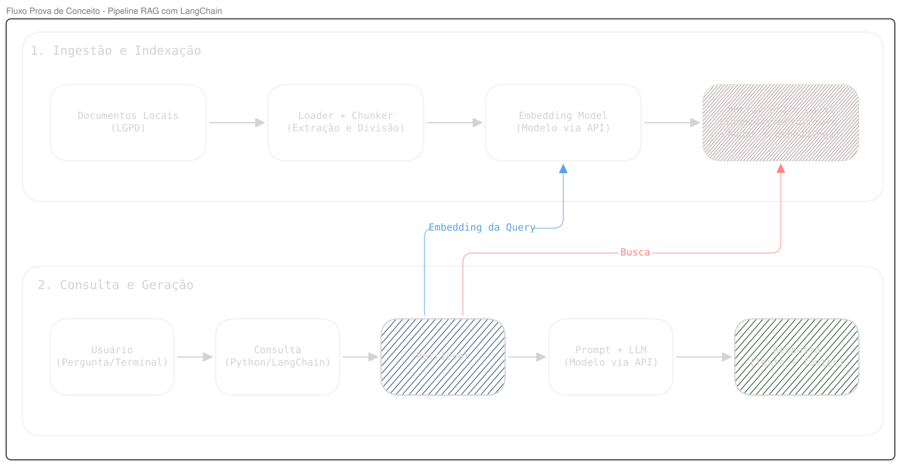

# Legativa — Prova de Conceito (PoC)

## 1. Objetivo

Validar a viabilidade técnica de um pipeline de **Retrieval-Augmented Generation (RAG)** para recuperação de informações jurídicas e geração de respostas fundamentadas na Lei Geral de Proteção de Dados (LGPD).

A PoC deverá permitir que um usuário realize perguntas pelo terminal e receba respostas textuais acompanhadas das fontes recuperadas.

## 2. Escopo e Decisões Técnicas

A solução será implementada como uma aplicação Python simples, utilizando **LangChain** para integrar os componentes do pipeline.

A base de conhecimento será composta exclusivamente pelo **PDF oficial e atualizado da Lei nº 13.709/2018 (LGPD)**.

**Fonte documental:**
- **Órgão:** Câmara dos Deputados.
- **Documento:** Lei nº 13.709/2018 (texto atualizado)
- **Origem:** [Legislação atualizada](https://www2.camara.leg.br/legin/fed/lei/2018/lei-13709-14-agosto-2018-787077-normaatualizada-pl.html).
- **Data de acesso:** 17/11/2026.
- **Arquivo local:** `documents/lgpd.pdf`.

| Responsabilidade           | Tecnologia                                       |
| -------------------------- | ------------------------------------------------ |
| Linguagem                  | Python                                           |
| Orquestração RAG           | LangChain                                        |
| Carregamento de documentos | pypdf + BaseLoader                               |
| Divisão do texto           | RecursiveCharacterTextSplitter                   |
| Embeddings                 | HuggingFaceEmbeddings + multilingual-e5-small    |
| Armazenamento vetorial     | InMemoryVectorStore                              |
| Recuperação                | Retriever com busca por similaridade             |
| Geração de respostas       | ChatOllama com Gemma 3 4B                        |  
| Interface                  | Terminal                                         |

**Configurações adotadas**
- Chunking com `chunk_size=1000`, `chunk_overlap=150` e `add_start_index=True`.
- Embeddings de 384 dimensões, executados localmente na CPU.
- Armazenamento vetorial em memória, reconstruído a cada execução.
- Geração com `temperature=0` e instruções para utilização do contexto recuperado.

A PoC não utilizará API HTTP, interface gráfica, banco de dados persistente ou mecanismos avançados de recuperação. Também não realizará avaliações automatizadas de conformidade nem processará documentos técnicos de sistemas reais.

## 3. Componentes

| Componente          | Responsabilidade                                           |
| ------------------- | ---------------------------------------------------------- |
| **Document Loader** | Carregar o PDF e extrair seu conteúdo textual e metadados. |
| **Text Splitter**   | Dividir o conteúdo em chunks.                              |
| **Embedding Model** | Gerar representações vetoriais dos chunks e das consultas. |
| **Vector Store**    | Armazenar os chunks, embeddings e metadados em memória.    |
| **Retriever**       | Recuperar os trechos mais relevantes à pergunta.           |
| **Prompt Template** | Combinar instruções, pergunta e contexto recuperado.       |
| **LLM**             | Gerar uma resposta utilizando o contexto recuperado.       |

## 4. Fluxos de Execução

A figura a seguir apresenta o fluxo geral da PoC, contemplando as etapas de ingestão, recuperação e geração.

### 4.1. Ingestão e Indexação

1. Carregar o PDF oficial da LGPD.
2. Extrair o texto e preservar os metadados de origem.
3. Dividir o conteúdo em chunks.
4. Gerar embeddings dos chunks.
5. Armazenar os textos, vetores e metadados no Vector Store.

### 4.2. Consulta e Geração

1. Receber a pergunta do usuário pelo terminal.
2. Encaminhar a consulta ao Retriever.
3. Gerar o embedding da pergunta e consultar o Vector Store.
4. Recuperar os chunks mais relevantes.
5. Construir o prompt com a pergunta e os trechos recuperados.
6. Solicitar à LLM uma resposta fundamentada no contexto.
7. Apresentar a resposta e as referências dos trechos utilizados.

## 5. Critérios de Validação

A validação será realizada por meio de perguntas selecionadas sobre a LGPD e inspeção manual dos resultados.

| Critério            | Verificação                                                  |
| ------------------- | ------------------------------------------------------------ |
| **Extração**        | O conteúdo do PDF foi carregado corretamente.                |
| **Indexação**       | Os chunks e seus embeddings foram armazenados.               |
| **Recuperação**     | Os trechos recuperados são relevantes para a consulta.       |
| **Fundamentação**   | A resposta corresponde às informações presentes no contexto. |
| **Rastreabilidade** | As fontes e os trechos recuperados podem ser identificados.  |

Os experimentos, resultados e limitações identificadas serão registrados separadamente em `docs/experiments.md`.

## 6. Resultado Esperado

Demonstrar o funcionamento integrado dos componentes fundamentais do RAG e identificar limitações que possam orientar as decisões técnicas da primeira versão estruturada da Legativa.

A PoC será considerada concluída quando os dois fluxos estiverem funcionais e seus resultados tiverem sido avaliados.
